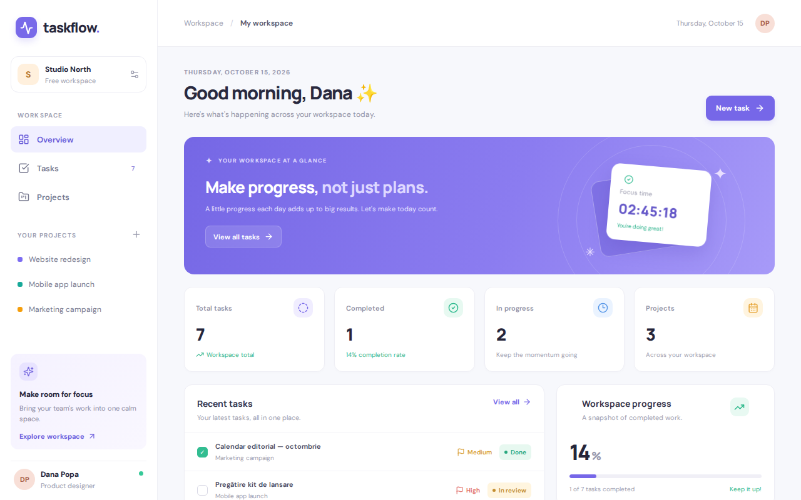
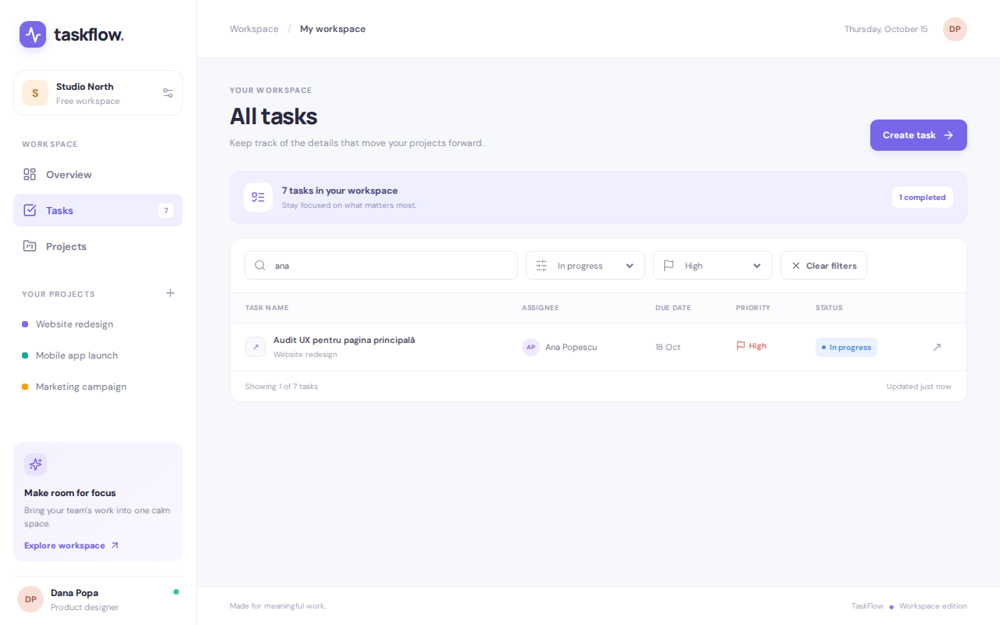
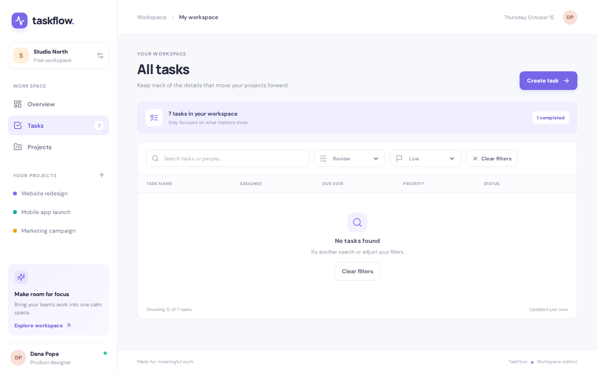
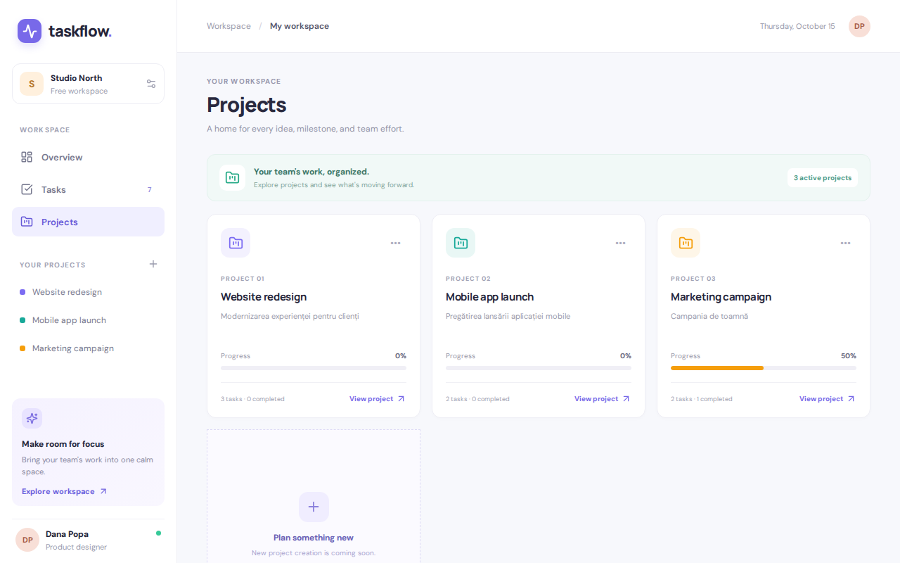
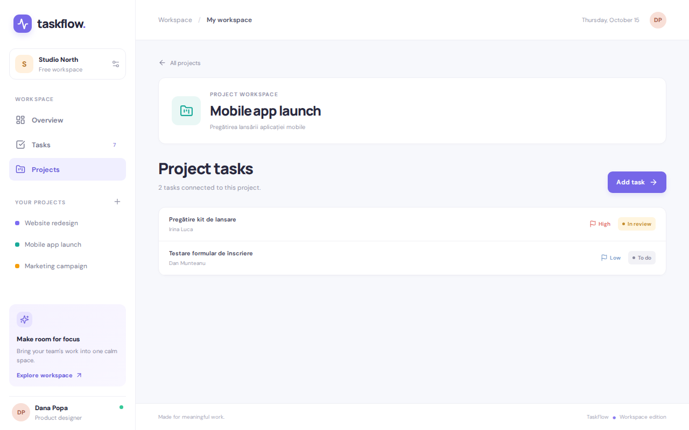
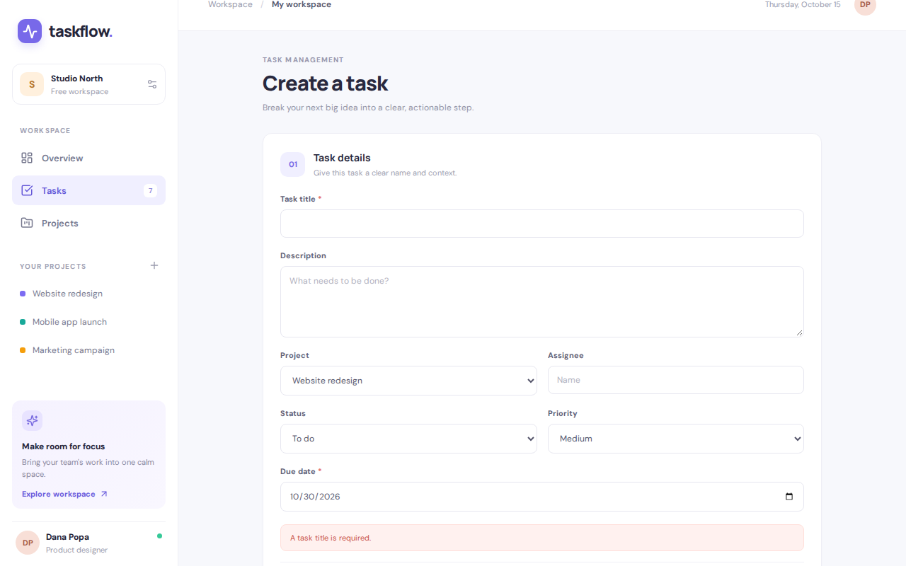
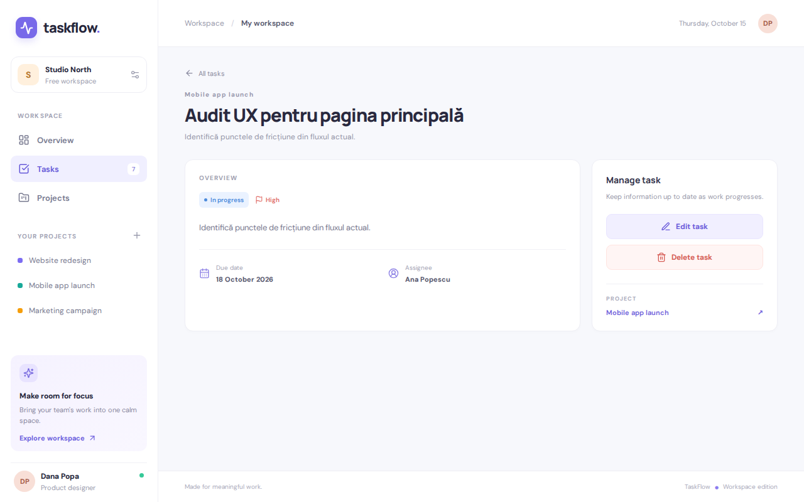
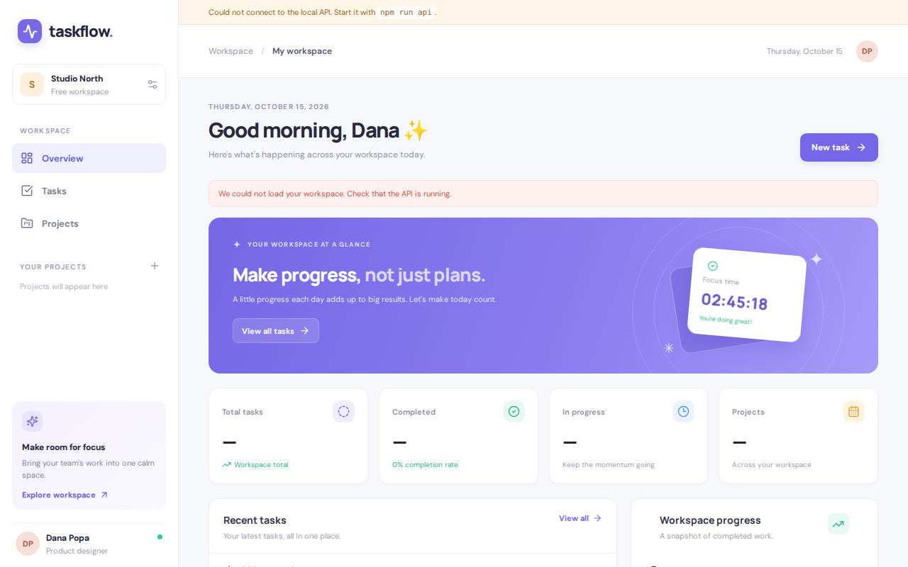
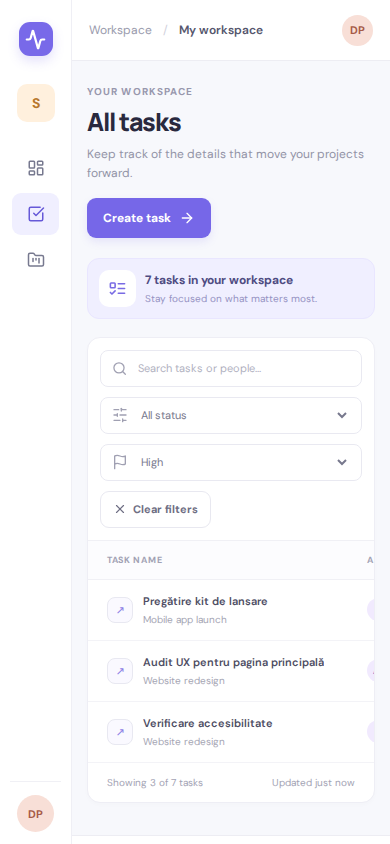

# Task_apsw_Vlad.F-Alex.B-Ilie.G

Test practic la disciplina **Asistență pentru programarea site-urilor web (APSW)**, realizat pe baza aplicației TaskFlow.

## Echipa

| Nume | Cont GitHub | Responsabil pentru |
|------|-------------|--------------------|
| Fulga Vlad | [Vuvucito06](https://github.com/Vuvucito06) | pagina Tasks (#1–#3), filtrul după prioritate (#11), verificarea finală (#12) |
| Batlan Alex | [5SSHift](https://github.com/5SSHift) | Dashboard și Projects (#4–#7) |
| Ghetan Ilie | [Ghetan-Ilie](https://github.com/Ghetan-Ilie) | detaliile sarcinii și formularul (#8–#10) |

Fiecare bug are un issue pe GitHub, atribuit unui membru al echipei. Fiecare membru a lucrat pe propriul branch și a deschis un Pull Request către `main`: [#13](https://github.com/Vuvucito06/task_apsw_Vlad.F-Alex.B-Ilie.G/pull/13) (Vlad), [#14](https://github.com/Vuvucito06/task_apsw_Vlad.F-Alex.B-Ilie.G/pull/14) (Ilie), [#15](https://github.com/Vuvucito06/task_apsw_Vlad.F-Alex.B-Ilie.G/pull/15) (Alex). Progresul este urmărit în [milestone-ul „Evaluare TaskFlow”](https://github.com/Vuvucito06/task_apsw_Vlad.F-Alex.B-Ilie.G/milestone/1).

> **Stare:** toate cele 10 bug-uri sunt reparate, filtrul după prioritate este implementat, iar verificarea finală pe `main` a trecut.

## Bug-uri reparate

| Issue | Problema | Soluția | Fișier | Responsabil | PR |
|-------|----------|---------|--------|-------------|----|
| [#1](https://github.com/Vuvucito06/task_apsw_Vlad.F-Alex.B-Ilie.G/issues/1) | Filtrul de status „In progress” nu afișa nicio sarcină. | Statusul ales este comparat direct cu cel din date. Înainte era transformat în „In Progress”, valoare care nu există în `db.json`. | `Tasks.jsx` | Fulga Vlad | [#13](https://github.com/Vuvucito06/task_apsw_Vlad.F-Alex.B-Ilie.G/pull/13) |
| [#2](https://github.com/Vuvucito06/task_apsw_Vlad.F-Alex.B-Ilie.G/issues/2) | Căutarea după persoană ținea cont de majuscule. | Numele persoanei este comparat cu litere mici, la fel ca titlul. | `Tasks.jsx` | Fulga Vlad | [#13](https://github.com/Vuvucito06/task_apsw_Vlad.F-Alex.B-Ilie.G/pull/13) |
| [#3](https://github.com/Vuvucito06/task_apsw_Vlad.F-Alex.B-Ilie.G/issues/3) | Contorul de sarcini din meniul lateral era mereu „7”. | Numărul vine din API și se actualizează după creare și ștergere. | `App.jsx` | Fulga Vlad | [#13](https://github.com/Vuvucito06/task_apsw_Vlad.F-Alex.B-Ilie.G/pull/13) |
| [#4](https://github.com/Vuvucito06/task_apsw_Vlad.F-Alex.B-Ilie.G/issues/4) | Cardul „In progress” din Dashboard arăta mereu 0. | Statusul este comparat cu `In progress`, cum apare în date, nu cu `In Progress`. | `Dashboard.jsx` | Batlan Alex | [#15](https://github.com/Vuvucito06/task_apsw_Vlad.F-Alex.B-Ilie.G/pull/15) |
| [#5](https://github.com/Vuvucito06/task_apsw_Vlad.F-Alex.B-Ilie.G/issues/5) | „View all” din Dashboard ducea înapoi la Overview. | Linkul duce la `/tasks`. Înainte ducea la `/task`, rută care nu există. | `Dashboard.jsx` | Batlan Alex | [#15](https://github.com/Vuvucito06/task_apsw_Vlad.F-Alex.B-Ilie.G/pull/15) |
| [#6](https://github.com/Vuvucito06/task_apsw_Vlad.F-Alex.B-Ilie.G/issues/6) | „View project” ducea înapoi la Overview. | Linkul duce la `/projects/:id`. Înainte ducea la `/project/:id`. | `Projects.jsx` | Batlan Alex | [#15](https://github.com/Vuvucito06/task_apsw_Vlad.F-Alex.B-Ilie.G/pull/15) |
| [#7](https://github.com/Vuvucito06/task_apsw_Vlad.F-Alex.B-Ilie.G/issues/7) | Cu API-ul oprit, Dashboard și Projects păreau goale, fără niciun mesaj de eroare. | Eroarea este tratată cu `.catch()` și se afișează un mesaj clar, ca pe pagina Tasks. | `Dashboard.jsx`, `Projects.jsx` | Batlan Alex | [#15](https://github.com/Vuvucito06/task_apsw_Vlad.F-Alex.B-Ilie.G/pull/15) |
| [#8](https://github.com/Vuvucito06/task_apsw_Vlad.F-Alex.B-Ilie.G/issues/8) | După ștergerea unei sarcini se ajungea pe Overview, nu în lista de sarcini. | După ștergere se deschide `/tasks`. Înainte se deschidea `/task`, rută care nu există. | `TaskDetails.jsx` | Ghetan Ilie | [#14](https://github.com/Vuvucito06/task_apsw_Vlad.F-Alex.B-Ilie.G/pull/14) |
| [#9](https://github.com/Vuvucito06/task_apsw_Vlad.F-Alex.B-Ilie.G/issues/9) | După editare, sarcina își pierdea proiectul. | `projectId` este salvat ca număr (`Number(...)`), nu ca text. | `TaskDetails.jsx` | Ghetan Ilie | [#14](https://github.com/Vuvucito06/task_apsw_Vlad.F-Alex.B-Ilie.G/pull/14) |
| [#10](https://github.com/Vuvucito06/task_apsw_Vlad.F-Alex.B-Ilie.G/issues/10) | Formularul accepta un titlu format doar din spații. | Titlul este verificat după `trim()`, la creare și la editare. | `TaskForm.jsx` | Ghetan Ilie | [#14](https://github.com/Vuvucito06/task_apsw_Vlad.F-Alex.B-Ilie.G/pull/14) |

## Funcționalitatea nouă: filtru după prioritate

[#11](https://github.com/Vuvucito06/task_apsw_Vlad.F-Alex.B-Ilie.G/issues/11), Fulga Vlad, [PR #13](https://github.com/Vuvucito06/task_apsw_Vlad.F-Alex.B-Ilie.G/pull/13)

Pe pagina **Tasks**, lângă filtrul de status, există un filtru „Filter by priority” cu opțiunile All priorities, Low, Medium și High.

- Funcționează împreună cu căutarea și cu filtrul de status.
- „Showing X of Y tasks” arată numărul de sarcini filtrate.
- Când nu există rezultate, apare starea goală „No tasks found”.
- Butonul „Clear filters” resetează toate filtrele și apare în bara de filtre când un filtru este activ.

## Capturi de ecran

| | |
|---|---|
| <br>**Overview:** cardul „In progress” arată 2 (#4), iar contorul Tasks din meniu arată 7 (#3). | <br>**Tasks:** căutare „ana” + status „In progress” + prioritate „High” → o sarcină (#1, #2, #11). |
| <br>**Tasks:** o combinație fără rezultate afișează starea goală și „Clear filters” (#11). | <br>**Projects:** „View project” deschide pagina proiectului (#6). |
| <br>**Detaliile proiectului**, deschise din „View project” (#6). | <br>**Formular:** un titlu format doar din spații este respins (#10). |
| <br>**Detaliile sarcinii** după mutarea în alt proiect: proiectul nou apare corect (#9). | <br>**Overview cu API-ul oprit:** mesaj de eroare și statistici „—” (#7). |
| <br>**Tasks pe telefon:** filtrele se așază pe rânduri și rămân utilizabile. | |

## Testare

Verificarea finală ([#12](https://github.com/Vuvucito06/task_apsw_Vlad.F-Alex.B-Ilie.G/issues/12)) a fost făcută pe `main`, cu `npm run api` și `npm run dev` pornite și cu API-ul rulând pe o copie a `db.json`. Rezultate:

- 97 de verificări automate în browser (Chromium), toate trecute;
- `npm run build` rulează fără erori.

Jurnalul de testare completat după [docs/TESTING_TEMPLATE.md](docs/TESTING_TEMPLATE.md) se află în [PR #16](https://github.com/Vuvucito06/task_apsw_Vlad.F-Alex.B-Ilie.G/pull/16).

## Pornire rapidă

```bash
npm install     # instalează dependențele
npm run api     # terminal 1: API-ul JSON Server pe http://localhost:3001
npm run dev     # terminal 2: aplicația React pe http://localhost:5173
```

## Structura proiectului

```text
├── db.json                 # datele de test (proiecte și sarcini) servite de JSON Server
├── docs/
│   ├── TESTING_TEMPLATE.md # șablonul jurnalului de testare
│   └── screenshots/        # capturile de ecran din acest README
├── index.html              # pagina HTML în care se montează aplicația
├── package.json            # scripturi npm și dependențe
├── vite.config.js          # configurația Vite
└── src/
    ├── main.jsx            # punctul de intrare React + BrowserRouter
    ├── App.jsx             # layout-ul (sidebar, topbar) și rutele aplicației
    ├── api.js              # funcțiile de comunicare cu API-ul REST
    ├── styles.css          # stilurile aplicației
    ├── components/         # componente reutilizabile (formular, badge-uri, titluri)
    └── pages/              # paginile: Dashboard, Tasks, TaskDetails, NewTask, Projects, ProjectDetails
```

---

_Mai jos este enunțul original al evaluării, primit de la cadrul didactic._

# TaskFlow — proiect de evaluare

TaskFlow este o aplicație React pentru gestionarea proiectelor și sarcinilor unei echipe. Repository-ul este folosit pentru o evaluare practică la disciplina **Asistență pentru programarea site-urilor web**.

## Scopul evaluării

Pornind de la aplicația existentă, fiecare student trebuie să:

1. investigheze aplicația și să identifice **10 bug-uri/erori**;
2. reproducă și să corecteze fiecare problemă;
3. implementeze funcționalitatea suplimentară descrisă mai jos;
4. verifice aplicația și să documenteze modificările;
5. trimită soluția printr-un Pull Request către repository-ul personal derivat din proiectul inițial.

Nu modificați direct repository-ul cadrului didactic. Lucrați în propriul fork.

## Tehnologii

- React + Vite
- React Router
- JSON Server ca API REST local
- Lucide React pentru pictograme
- CSS responsive, fără framework CSS suplimentar

## Cerințe tehnice

- Node.js 18+ și npm instalate.
- Git instalat.
- Un cont GitHub.

## Instalare și pornire

Clonați propriul fork, apoi instalați dependențele:

```bash
npm install
```

Porniți API-ul într-un terminal:

```bash
npm run api
```

API-ul va fi disponibil la `http://localhost:3001`.

Porniți aplicația într-un al doilea terminal:

```bash
npm run dev
```

Deschideți URL-ul local afișat de Vite, de regulă `http://localhost:5173`.

Pentru verificarea build-ului:

```bash
npm run build
```

> API-ul trebuie să ruleze separat de serverul Vite. Datele de test se află în `db.json`; operațiile de creare, editare și ștergere modifică acest fișier prin JSON Server.

## Funcționalități existente

- Dashboard cu statistici și sarcini recente.
- Listă de sarcini cu căutare și filtre.
- Vizualizarea detaliilor unei sarcini.
- Crearea, editarea și ștergerea sarcinilor prin API.
- Listă de proiecte și pagină de detalii a proiectului.
- Navigare între pagini prin React Router.
- Date inițiale pentru testare în `db.json`.

Unele comportamente ale aplicației nu funcționează corect intenționat. Investigați aplicația prin utilizare, inspectarea codului și verificarea cererilor API.

## Funcționalitatea suplimentară de implementat

### Filtrare și organizare după prioritate

Implementați o opțiune completă de filtrare a sarcinilor după prioritate: **Low, Medium, High**.

Criterii de acceptare:

- utilizatorul poate selecta o prioritate sau „Toate prioritățile”;
- filtrul funcționează împreună cu căutarea și filtrul după status, fără ca un criteriu să îl anuleze pe celălalt;
- numărul sarcinilor afișate corespunde rezultatului filtrat;
- starea goală este afișată când nu există rezultate;
- controlul are etichetă accesibilă și stil vizual coerent cu aplicația;
- filtrele pot fi resetate ușor.

Nu este suficient să adăugați doar un element vizual: filtrarea trebuie să funcționeze efectiv.

## Flux GitHub obligatoriu

### 1. Fork și clonare

1. Deschideți repository-ul inițial furnizat de cadrul didactic.
2. Apăsați **Fork** pentru a crea o copie în contul propriu.
3. Clonați fork-ul:

```bash
git clone https://github.com/USERNAME/taskflow-evaluare.git
cd taskflow-evaluare
npm install
```

Înlocuiți `USERNAME` cu numele contului vostru GitHub.

### 2. Creați un branch de lucru

```bash
git checkout -b feature/fix-taskflow
```

Lucrați pe acest branch, nu direct pe `main`.

### 3. Salvați modificările prin commit-uri clare

Exemple de mesaje de commit:

```bash
git add .
git commit -m "fix: correct task status filtering"
git commit -m "fix: validate task form"
git commit -m "feat: add priority filter"
```

Fiecare commit trebuie să reprezinte o schimbare logică. Nu este obligatoriu să folosiți exact aceste mesaje, dar mesajele trebuie să fie explicite.

### 4. Publicați branch-ul

```bash
git push -u origin feature/fix-taskflow
```

### 5. Deschideți Pull Request

Din GitHub, creați un Pull Request din branch-ul de lucru către `main` din propriul fork. Dacă cadrul didactic solicită explicit un PR către repository-ul inițial, selectați repository-ul cadrului didactic ca bază.

Titlu recomandat: `Evaluare TaskFlow — Nume Prenume`

În descriere includeți:

- lista celor 10 bug-uri identificate;
- pașii prin care ați reprodus fiecare problemă;
- explicația soluției aplicate;
- descrierea funcționalității noi;
- verificările manuale și comenzile de testare executate;
- eventuale limitări rămase.

## Livrabile

- Fork GitHub cu istoricul commit-urilor.
- Branch de lucru.
- Pull Request completat.
- Cod funcțional și formatat.
- Descrierea celor 10 bug-uri și a soluțiilor.
- Funcționalitatea suplimentară implementată.
- Build fără erori.

## Reguli de lucru

- Nu eliminați funcționalități existente pentru a evita repararea lor.
- Nu înlocuiți API-ul cu date hardcodate în componente.
- Nu includeți fișierele `node_modules` sau `dist` în Git.
- Testați și scenariile cu liste goale, date invalide și răspunsuri API eșuate.
- Codul trebuie să fie lizibil și împărțit logic în componente.
- Fiecare student trebuie să lucreze individual și să poată explica propriile modificări.

## Criterii de evaluare

Baremul detaliat este comunicat de cadrul didactic. Evaluarea ia în considerare corectitudinea remedierilor, calitatea implementării, utilizarea API-ului, navigarea, testarea și calitatea Pull Request-ului.
